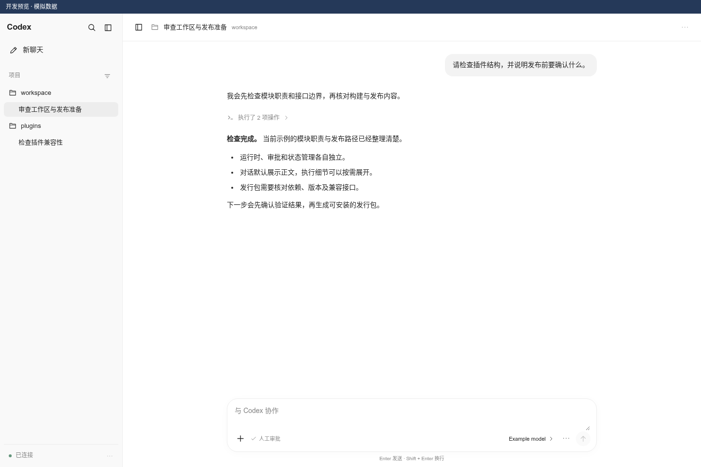

# dsh-mek-codex

MakeEpoch 的 DSH Codex 集成插件。在 DSH 中浏览 Codex 会话、查看原始历史，并在明确进入会话后继续对话。

会话通过本机 `codex app-server` 读取和操作，继续使用 Codex 自己的存储。浏览器代码由 DSH 加载并复用 DSH 的 React。

0.2.0 的界面布局示意（模拟数据；0.2.1 的项目导航已按注册项目修正）：



[详细交互分析](docs/interaction-design.md) · [代码审查与验证](docs/review-0.2.0.md)

0.2.6 修复发送确认误报，思考摘要结束后消失，并提供审批、模型／推理档菜单与 DSH 语音输入，详见 [输入区交互](docs/composer.md)。

0.2.5 增加插件内文件预览侧栏，支持代码行号、Markdown、图片、PDF 和下载，详见 [文件预览说明](docs/file-preview.md)。

0.2.4 增加当前聊天自动同步与执行状态核实，详见 [同步机制及边界](docs/conversation-sync.md)。

0.2.3 增加列表本地缓存与后台更新，并移除多余标题图标，详见 [列表加载说明](docs/list-cache.md)。

0.2.2 修复空摘要折叠栏与流式摘要被空数组遮挡，详见 [摘要修复说明](docs/fix-0.2.2.md)。

0.2.1 修复真实 DSH React 18 打开聊天崩溃，并改为读取真实项目归属，详见 [修复说明](docs/fix-0.2.1.md)。

## 功能

- 原生注册项目、置顶和自定义分区导航；项目多根目录与历史明确聊天归属兼容。
- 项目折叠与逐步展开、标题搜索、来源与归档筛选、分页和虚拟滚动；其他聊天独立收纳。
- 列表优先显示本地缓存，再后台更新；更新期间保持列表和选中项，失败时可重试。
- 默认只读预览；点击「进入会话」后才接入线程并显示输入框。
- 居中对话阅读区、安全 Markdown、命令分组折叠；思考摘要仅在输出时显示，结束后移除。
- 底部协作输入框、图片选择和粘贴、插话、排队、中断及模型／推理档菜单。
- 可选“请求批准 / 帮我批准”；复用 DSH 语音输入，转写后填入草稿，由用户确认发送。
- 切换聊天保留本次页面会话的草稿；窄屏使用项目导航抽屉。
- 新建、重命名、归档、取消归档、删除会话。
- 默认由用户处理命令与文件修改审批；选择“帮我批准”后由 Codex 自动审核，交互请求超时和连接关闭时仍安全拒绝。
- 发送前记录未确认状态；未取得匹配终态时阻止重发，支持读取落盘轮次核对。

## 安装

需要 Node.js `^22.19.0 || >=24`、DSH `>=0.2.1-rc.2 <0.3.0`，以及已登录的 Codex CLI。本版真实协议冒烟验证使用 Codex `0.165.0`；实验接口可能随 CLI 版本改变。

从 [Releases](https://github.com/MakeEpoch/dsh-mek-codex/releases) 下载发行包，然后执行：

```sh
dsh plugin --profile web add -w ./dsh-mek-codex-0.2.6.tgz --ignore-scripts
```

也可在仓库内构建和打包，再安装生成的 `.tgz`：

```sh
npm ci
npm run build
npm pack
```

安装包包含全部插件代码；Host 依赖 Node 内置模块与 `ws`，浏览器复用 DSH 提供的 React。使用包管理器将插件及运行依赖独立安装到 profile，不依赖开发目录链接。安装后按 DSH 的方式重启 web profile。

### 从 dsh-codex-panel 迁移

`dsh-codex-panel` 是本项目的旧名称。升级前先释放旧插件的运行时，然后移除旧包再安装新版，避免两个插件同时启动 app-server：

```sh
dsh plugin --profile web remove dsh-codex-panel
dsh plugin --profile web add -w ./dsh-mek-codex-0.2.6.tgz --ignore-scripts
```

新版保留 `codex-panel` 配置行和面板 ID，继续使用 `$DSH_HOME/codex-panel/state.json`（未设 DSH_HOME 时为 `~/.dsh/codex-panel/state.json`），并兼容旧 RPC 路径。自定义的 `stateDir`、`codexBin` 配置应原样保留。

## 代码结构

```text
host/
  index.js         DSH 生命周期与 HTTP RPC 路由
  transport.js     stdio JSON-RPC 传输
  runtime.js       app-server 进程、握手、串行启动/停止/重启
  approvals.js     审批队列、决定校验、超时与断线拒绝
  events.js        事件缓冲、长轮询与线程状态
  state.js         发送安全状态的原子文件替换
  handlers.js      会话、发送、核对、图片等业务 RPC
  navigation.js    原生项目与桌面导航元数据的只读适配
  observer.js      共享实例的 Unix socket 只读连接
  sync.js          状态来源核实、最新两轮及修订检查
client/
  index.js         DSH 插槽注册
  panel.js         列表、筛选和主界面组合
  list-cache.js    有界列表元数据缓存，不保存正文或权限
  hooks/use-session-list.js 缓存首屏、后台更新、分页和请求取消
  conversation.js  会话预览、输入及模型设置
  hooks/           会话操作、按线程维护的流式事件
  components/      列表、轮次、审批和公共组件
  rpc.js           浏览器 RPC 适配
  helpers.js       展示数据转换
  styles.js        面板样式
client/jsx-runtime.js 统一使用 DSH 注入的 React 创建元素
shared/identity.js 包名、版本与兼容标识
lib/client.js      自动生成的 DSH 浏览器入口，不手工修改
lib/index.js       兼容旧开发入口
```

Host 不依赖浏览器模块；Client 不访问文件系统或直接启动 Codex。构建时校验包名与握手版本一致，检查时核对提交的 bundle 是否与源码一致。

## RPC 与配置

新路径是 `POST /api/dsh-mek-codex`，兼容 `/api/dsh-codex-panel`。信封内 `method` 必须与对应路径同名：

```json
{"type":"client-request","method":"dsh-mek-codex","rpcId":"1","payload":{"method":"health","payload":{}}}
```

返回 `{"type":"server-response","rpcId":"1","result":{"ok":true,"value":{}}}`；错误放在 `result.error`，包含 `code` 和 `message`。

业务方法包括 `health`、`restart`、`release.all`、`list`、`turns`、`read`、`start`、`rename`、`archive`、`unarchive`、`remove`、`resume`、`release`、`send`、`steer`、`interrupt`、`queue.add`、`queue.list`、`settings`、`models`、`events`、`presence`、`reconcile`、`approval.decide`、`upload.image`。契约实现见 `host/handlers.js`。

项目与聊天导航使用本机 `CODEX_HOME`（默认 `~/.codex`）中的元数据；仅兼容读取 `.codex-global-state.json` 的导航字段，可用 `globalStateFile` 指定文件。不会写入此文件或按 cwd 推断归属。

配置项：`codexBin` 指定可执行文件（其次读取 `CODEX_BIN`，默认 `codex`）；`stateDir` 指定状态文件与上传目录。状态目录含草稿文本和图片，应按私人会话数据管理。

## 开发与验证

```sh
npm ci
npm run build
npm run check
npm test
npm run test:client
npm run pack:check
```

`npm test` 使用虚构数据和临时目录，不连接真实账户。`npm run check` 检查未定义引用和构建产物一致性。CI 在 Node 22、24 上执行同样的检查，聊天 bundle 的渲染回归使用真实 DSH 对应的 React 18.3.1。

```sh
npm run test:live
node scripts/preview.mjs
```

`test:live` 会启动独立 app-server，验证握手、重启和有界的只读会话接口，日志可能含本机会话信息，不应上传。浏览器预览位于 `http://127.0.0.1:4319`，使用模拟数据加载真实 `lib/client.js`，不代表已安装 DSH 的验收。

`verify-s2.mjs`、`verify-s3.mjs` 和 `probe-s3.mjs` 是保留的手工协议诊断脚本，不属于默认测试。后两者会创建测试线程并调用模型，其中 verify-s3 会请求一个用户目录中的 marker 写入以测试拒绝审批；仅在明确需要该验收时运行。探针读取既有线程需显式设置 `CODEX_PROBE_THREAD_ID`。

## 行为边界

- 接入线程后 app-server 可能持有 writer；单独释放会话只放弃面板 ownership，交还其他客户端需要释放运行时。重启会影响本插件所有已接入线程。
- `send`、`steer`、`interrupt`、排队发送和模型修改要求先进入会话。
- 没有 `turn/start` 返回的轮次 ID 时，即使历史中出现相似内容，也不会推断发送成功或自动重发。状态文件损坏或持久化失败会阻止发送。
- 本版交互审批支持命令执行与文件修改；权限授予、用户问答、MCP elicitation 等其他服务端请求返回明确错误，尚无对应表单。
- `turn/diff/updated` 被接收但尚不展示；轮次计数和断线核对最多读取 500 轮。
- 会话状态属于本插件运行时视角，无法据此认定其他 Codex 客户端是否正在运行。
- 真实模型消息、真实审批命令和麦克风录音与模拟回归分别验收，不以构建或服务健康检查替代。0.2.0 的历史审查记录见 [本次审查](docs/review-0.2.0.md)。

协议依据：[OpenAI Codex App Server 官方文档](https://developers.openai.com/codex/app-server/)。
